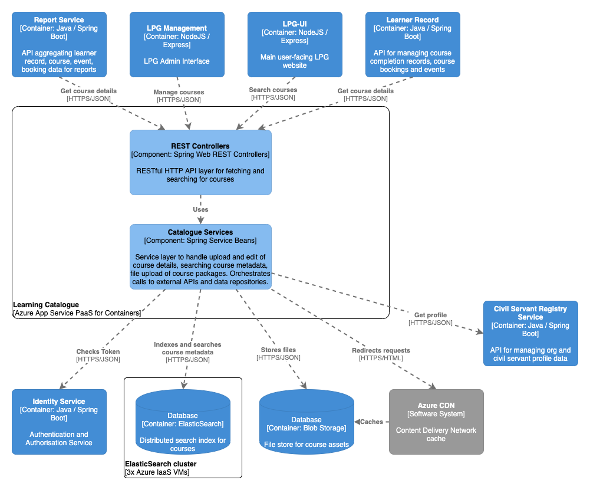

# Learning Catalogue

## Purpose

Spring Boot based RESTful API for uploading course materials (SCORM packages, single files, etc) and indexing metadata of courses (title, description, etc). Course metadata is stored in ElasticSearch running in an IaaS-managed VM cluster and content files are uploaded to Azure Blob Storage for persistence and replication. Azure CDN is also configured to cache course contents referenced in Blob Storage, so Learning Catalogue returns course content URLs prefixed with the CDN path. Learning Catalogue is called directly by LPG-UI and LPG-Management for searches and also by other APIs for fetching specific course details.

## Component overview

See the `diagram/` folder for diagram source in draw.io XML format

## Dependencies

### Build-time

For a complete list of build dependencies check the `build.gradle` file. The main source dependencies are:  
- Java 25 (OpenJDK 25)
- Spring Boot 4.1.1 (webmvc, jersey, security, actuator, data-jpa, data-elasticsearch, oauth2-resource-server, oauth2-client, flyway)
- Spring Data JPA & Hibernate
- MySQL Connector / Flyway MySQL
- Spring Data Elasticsearch & Elasticsearch Java Client
- Springdoc OpenAPI (Swagger UI) 3.1.1
- Azure Storage 8.6.6
- Azure App Insights 2.6.4
- Apache Tika 4.1.0

### Test-time

For a complete list of test dependencies check the `build.gradle` file. The main test dependencies are:  
- Spring Boot Starter Test (including WebMvc, Security, Data JPA, and Data Elasticsearch test starters)
- JUnit Jupiter 6.1.3
- Mockito 5.24.0
- Testcontainers Elasticsearch
- H2 Database (in-memory testing)
- Jayway JsonPath

### Runtime 

#### Other LPG Services

- `identity-service` for OAuth2 token validation and service authentication
- `learner-record` for retrieving data on event bookings associated with courses
- `civil-servant-registry-service` for getting organisation data

#### External integrations

- `Rustici Engine` for SCORM / TinCan e-learning package management and manifests
- Azure CDN / Rustici CDN referenced in returned content paths to ensure caching of blob storage hosted files

#### Data Stores

- MySQL for relational course data, status, tags, and hyperlinks
- ElasticSearch for indexing and searching course metadata
- Azure Blob Storage for persistence of course materials and SCORM packages

#### Data migrations

- Flyway database migrations (`src/main/resources/db/migration/`) for MySQL and H2

## Build, run, test, deploy

The application requires Java 25 (OpenJDK 25) installed to build and run.

Build the application using Gradle: `./gradlew build`.

Run the project with `./gradlew bootRun` or import the project into your IDE of choice such as IntelliJ or VS Code and use the IDE commands to run the application.

Run the unit tests using `./gradlew test` or choose individual test classes or packages using your IDE.

Integration tests relying on ElasticSearch can be run using `./gradlew integrationTest` and will execute the tests ending in 'IT' after attempting to start ES on local ports 9998/9999 (see `build.gradle` for more).

The application is packaged as a docker container image and includes an Azure App Insights Java agent for collecting metrics from the app - see `Dockerfile` in the root directory for the container definition. `hammer` is the log collector used for aggregating log output.

The application also includes a `Jenkinsfile` to define the Jenkins build pipeline stages and linking it to the docker image repository and correct terraform module.

Deployment is controlled via the Terraform scripts in the main PaaS repository, with per-environment configuration values referenced there and secrets injected from keybase.

## Configuration

Significant configuration properties are highlighted here. For the full configuration file see `src/main/resources/application.yml`

- `database` / `spring.datasource` connection and pooling settings for MySQL
- `spring.flyway` migration locations for database schema setup
- `identity` / `spring.security.oauth2` settings for token validation and OAuth2 client registration with the identity-service
- `record` connection settings and paths for the learner-record service
- `registry` connection settings for the civil-servant-registry-service
- `elasticsearch` connection settings for the ElasticSearch cluster and repositories
- `rustici` connection settings, tenant, and manifest configurations for Rustici Engine
- `azure` connection settings for Azure storage account, containers, and CDN paths
- `retention` configuration for course data retention period in days
- `springdoc` configuration for OpenAPI documentation and Swagger UI (`springdoc.api-docs.enabled`, `springdoc.swagger-ui.enabled`)

## API Documentation (OpenAPI & Swagger UI)

The service provides API documentation using OpenAPI 3 and Swagger UI via `springdoc-openapi`.

### Endpoints

- **OpenAPI Specification:**
  - `/v3/api-docs` (JSON format)
  - `/v3/api-docs.yaml` (YAML format)
  - `/v3/api-docs/swagger-config` (Swagger UI configuration)
- **Swagger UI:**
  - `/swagger-ui.html` (Redirects to Swagger UI)
  - `/swagger-ui/index.html` or `/swagger-ui/**` (Interactive web UI)

### Configuration

OpenAPI documentation generation and Swagger UI are disabled by default. They can be enabled using the following environment variables or configuration properties:

| Property | Environment Variable | Default | Description |
|---|---|---|---|
| `springdoc.api-docs.enabled` | `SPRINGDOC_API_DOCS_ENABLED` | `false` | Enables/disables the OpenAPI specification endpoints (`/v3/api-docs`) |
| `springdoc.swagger-ui.enabled` | `SPRINGDOC_SWAGGER_UI_ENABLED` | `false` | Enables/disables the interactive Swagger UI interface (`/swagger-ui/**`) |

*Note: When enabled, these documentation endpoints are accessible without OAuth2 authentication.*

## Licenses

Learning Catalogue is licensed by the MIT license, see `LICENSE` in the root folder for details. Dependent applications are licensed as according to their respective readme and license files.

